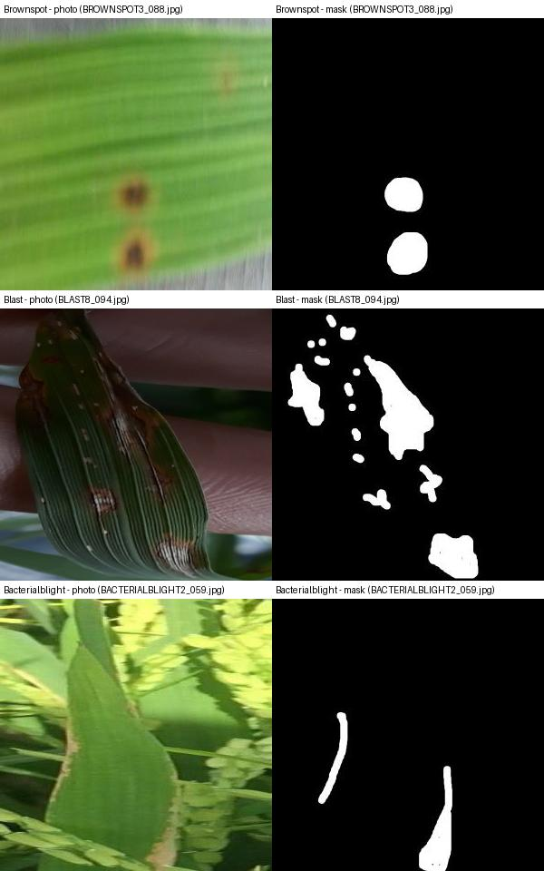

# PaddyGuard-TN: the datasets

All four datasets are public. Nothing is photographed or labelled by the project. This file describes each dataset in plain language, says where to get it, and explains what a mask is and why it matters.

## Dataset links (copy and paste)

| Dataset | Link |
| --- | --- |
| Paddy Doctor, Kaggle competition (the version used) | https://www.kaggle.com/c/paddy-disease-classification |
| Paddy Doctor, Hugging Face mirror (unofficial, backup only) | https://huggingface.co/datasets/anthony2261/paddy-disease-classification |
| Paddy Doctor, paper (earlier version) | https://arxiv.org/abs/2205.11108 |
| Sethy et al., Rice Leaf Disease Image Samples (Mendeley Data) | https://doi.org/10.17632/fwcj7stb8r.1 |
| RiceSeg-5932 masks (Mendeley Data) | https://doi.org/10.17632/92jc6w6mcy.1 |
| Dhan-Shomadhan (Mendeley Data) | https://doi.org/10.17632/znsxdctwtt.1 |
| Dhan-Shomadhan, paper | https://arxiv.org/abs/2309.07515 |
| Licence (CC BY 4.0) | https://creativecommons.org/licenses/by/4.0/ |

Paddy Doctor on Kaggle needs a free account and acceptance of the competition rules. The three Mendeley datasets are free to download without payment. The full 13-class Paddy Doctor version is on IEEE DataPort (login and subscription needed) and is not used here.

## 1. At a glance

| Code | Dataset | Origin | Size | Role in the project | Where to get it |
| --- | --- | --- | --- | --- | --- |
| `S` | **Paddy Doctor** (Kaggle competition version) | Tamil Nadu, India | 10,407 labelled photos, 10 classes, with rice variety and plant age; 3,469 unlabelled test photos (never used) | Training, validation and in-domain test of the classifier; field backgrounds for the simulated-shift test | [kaggle.com/c/paddy-disease-classification](https://www.kaggle.com/c/paddy-disease-classification) |
| `T1` | **Sethy et al.**, Rice Leaf Disease Image Samples | Odisha, India | 5,932 photos, 4 classes, about 300x300 px | First "stranger" test (zero-shot cross-dataset); leaves on which damage is measured | Mendeley Data, DOI [10.17632/fwcj7stb8r.1](https://doi.org/10.17632/fwcj7stb8r.1) |
| (T1 masks) | **RiceSeg-5932** | Masks for the Sethy photos | 5,932 masks, one per Sethy photo | Measuring how much of a leaf is damaged (severity) | Mendeley Data, DOI [10.17632/92jc6w6mcy.1](https://doi.org/10.17632/92jc6w6mcy.1) |
| `T2` | **Dhan-Shomadhan** | Bangladesh | 1,106 photos, 5 classes: 337 field background, 769 white background; about 1952x4160 px | Second "stranger" test; the 337 field photos are the main target, the white-background photos are a secondary row (`T2-white`) | Mendeley Data, DOI [10.17632/znsxdctwtt.1](https://doi.org/10.17632/znsxdctwtt.1); paper [arXiv 2309.07515](https://arxiv.org/abs/2309.07515) |

**Licence.** All four datasets are reported as **CC BY 4.0** ([creativecommons.org/licenses/by/4.0](https://creativecommons.org/licenses/by/4.0/)): credit the authors, link to the licence and note any changes. Paddy Doctor is a Kaggle competition, so its competition rules page must also be read for reuse limits.

**Simulated shift (`SX`).** A fifth, derived set is built in module M7 (not yet built): Sethy leaves cut out with their masks and pasted onto blurred Paddy Doctor field backgrounds, with blur, lighting and JPEG changes. It is always called *simulated*.

## 2. Where each dataset comes from, and how to download it

| Dataset | Download steps | Notes |
| --- | --- | --- |
| Paddy Doctor (Kaggle) | Create a free Kaggle account, join the competition at [kaggle.com/c/paddy-disease-classification](https://www.kaggle.com/c/paddy-disease-classification) and accept its rules, then download `train_images/`, `train.csv` (`image_id, label, variety, age`) and `sample_submission.csv`. It can also be attached directly inside a Kaggle notebook. | The 3,469 unlabelled `test_images/` are never used for evaluation. Original paper: Petchiammal et al., "Paddy Doctor: A Visual Image Dataset for Automated Paddy Disease Classification and Benchmarking," CODS-COMAD 2023 (IEEE DataPort; earlier version [arXiv 2205.11108](https://arxiv.org/abs/2205.11108)). |
| Paddy Doctor (alternatives) | Hugging Face mirror: [huggingface.co/datasets/anthony2261/paddy-disease-classification](https://huggingface.co/datasets/anthony2261/paddy-disease-classification) (about 10.4k images in Parquet with label, variety and age). The full 16,225-image, 13-class version is on IEEE DataPort and needs a login and a subscription. | The mirror is unofficial and its licence is not stated. Only the Kaggle version is used in this project. |
| Sethy (Rice Leaf Disease Image Samples) | Free download from Mendeley Data: [doi.org/10.17632/fwcj7stb8r.1](https://doi.org/10.17632/fwcj7stb8r.1) | Sethy et al., Mendeley Data, 2020. |
| RiceSeg-5932 | Free download from Mendeley Data: [doi.org/10.17632/92jc6w6mcy.1](https://doi.org/10.17632/92jc6w6mcy.1) | "RiceSeg-5932: Complete Pixel-Level Segmentation Masks for Rice Leaf Disease Images Samples," Mendeley Data, 2025. Masks were made in Label Studio. File names match the Sethy photos exactly (typos included). |
| Dhan-Shomadhan | Free download from Mendeley Data: [doi.org/10.17632/znsxdctwtt.1](https://doi.org/10.17632/znsxdctwtt.1) | Hossain et al., Mendeley Data, 2021; paper [arXiv 2309.07515](https://arxiv.org/abs/2309.07515). |

The TNAU and CIBRC sources used for the advisory (Phase 2) are not datasets: TNAU Agritech paddy expert-system pages and the CIBRC "Major Uses of Pesticides" PDFs (31.03.2024 edition), read by hand and typed into a knowledge base.

## 3. The datasets in detail

### 3.1 Paddy Doctor (`S`): the training data

- Field photos of rice plants taken in Tamil Nadu, each labelled with a disease or "normal", plus the **rice variety** (for example ADT45, KarnatakaPonni, Ponni) and the **plant's age**.
- 10 classes: bacterial leaf blight 479, bacterial leaf streak 380, bacterial panicle blight 337, blast 1,738, brown spot 965, dead heart 1,442, downy mildew 620, hispa 1,594, normal 1,764, tungro 1,088.
- Image size 480x640 (10,403 images) or 640x480 (4).
- After removing duplicate groups for splitting: 6,141 groups; split into train 7,334 / validation 1,587 / test 1,486 (whole groups per split, seed 42).
- Used to train and test the classifier, and as the source of field backgrounds for the simulated shift. The variety column allows a per-variety analysis (the first Paddy Doctor to Sethy cross-dataset benchmark with per-variety analysis is one of the project's contributions).

### 3.2 Sethy (`T1`): the first cross-dataset test and the leaves for severity

- Rice leaf photos from Odisha, 4 classes: bacterial blight 1,584, blast 1,440, brown spot 1,600, tungro 1,308 (5,932 in total).
- Images are only about 300x300 px, so they are never downscaled. About 7% of the `.jpg` files are actually PNG files and are re-encoded when cached.
- **Heavily duplicated:** 5,174 exact-duplicate pairs; the 5,932 photos form only **1,847** groups of near-identical images. Group-aware splitting and "one image per group" evaluation are therefore essential.
- Backgrounds vary: many photos are on plain or blurred backgrounds, but some show field backgrounds, a leaf held in a hand or a grey sheet. This has not yet been counted and will be checked in module M6.
- Split: segmenter train 4,074 / validation 927 / test 280 (87 bacterial blight, 66 blast, 79 brown spot, 48 tungro). The zero-shot classification test uses the 1,847 group representatives.
- The four classes are shared with Paddy Doctor: bacterial leaf blight, blast, brown spot, tungro.

### 3.3 RiceSeg-5932: the masks for Sethy

For every Sethy photo there is a second image, a **mask**, of the same size (see section 4). All 5,932 masks pair with a Sethy photo by file name.

### 3.4 Dhan-Shomadhan (`T2`): the second cross-dataset test

- Rice photos from Bangladesh, 5 classes, shot either on a **field background** or on a **white background**. Photos are large (about 1952x4160 px) and carry EXIF rotation tags.
- Field background (337): Browon Spot 49, Leaf Scaled 74, Rice Blast 74, Rice Turgro 76, Sheath Blight 64.
- White background (769): Brown Spot 90, Leaf Scaled 143, Rice Blast 198, Rice Tungro 119, Shath Blight 219.
- Folder names are kept exactly as shipped, typos included (`Browon Spot`, `Rice Turgro`, `Shath Blight`).
- Only three classes are shared with Paddy Doctor: **blast, brown spot, tungro**. Leaf Scaled and Sheath Blight have no counterpart and are excluded from the shared label space (606 of the 1,106 photos get a label).
- **Main target = the 337 field-background photos**, because Paddy Doctor is field photography, so field against field is the cleaner measure of dataset shift. They are split 40% calibration pool and 60% test (after duplicate removal). In the shared classes this leaves a pool of 79 and a test set of 119 (brown spot only 28, flagged low-n), so Dhan is treated as small-sample corroboration and Sethy as the main benchmark.
- The 769 white-background photos form the separate zero-shot-only row `T2-white` (401 photos in the shared classes).
- There are no masks for Dhan, so it is used only for classification and abstention.

## 4. What is a mask?

A mask is a stencil picture of the same size as the photo. Instead of showing the leaf, it answers one question: *which pixels are damaged?* It is black where nothing is wrong and white where the lesions are. Someone drew these by hand in an annotation tool.

Think of a leaf photo with a transparent sheet laid over it, and someone colouring in the diseased spots with a marker. The coloured sheet is the mask.

*Left: Sethy photo. Right: its RiceSeg mask (raw, unprocessed). Three example pairs. Photos are from Sethy and masks from RiceSeg-5932 (CC BY 4.0 as reported: credit them if the image is shown publicly).*

### What the masks mean (found by inspection in module M1)

- White marks the **lesions only** on a pure black background. There is **no separate "leaf" class**.
- The masks are JPG files, so their edges carry slight noise. A **threshold of 128** turns them into clean binary masks. On 300 sampled masks the mean lesion share is 6.2% at a threshold of 10 (noise counted), then 5.7% at 60, 5.5% at 128 and 5.3% at 200, so any value between about 60 and 200 gives nearly the same result.
- Lesions cover about **5% of mask pixels** on average.
- Because the leaf itself is not in the mask, the leaf area needed for the severity percentage must be derived separately (module M6).

### Why masks matter to the project

- A classifier can say "this is blast", but that is not enough. TNAU advises spraying once damage passes a threshold; for blast, about **5% of the leaf area** (taken from the TNAU expert-system page and still to be re-confirmed). So the system needs to know *how much* of the leaf is damaged, not just which disease.
- With a mask we count damaged pixels and divide by leaf pixels. That gives the **true severity** as a percentage.
- A second model (a segmentation network) is trained to predict the damaged area on its own and is checked against the masks.
- Because the true answer is known exactly, the same leaves can also be tested after being **pasted onto blurred field backgrounds** and degraded with blur, lighting changes and compression. The true severity stays known, so we measure how much the model's answer drifts. This is the **simulated** shift experiment. It is not real field photography.

## 5. Shared classes: why cross-dataset testing restricts the output

The classifier is trained on all 10 Paddy Doctor classes, but the other datasets contain only some of them. For a fair cross-dataset test, the model's output is restricted to the shared classes before the probabilities are computed.

| Pair | Shared classes |
| --- | --- |
| Paddy Doctor and Sethy (`S`, `T1`) | bacterial leaf blight, blast, brown spot, tungro (4) |
| Paddy Doctor and Dhan (`S`, `T2`) | blast, brown spot, tungro (3) |

The Paddy Doctor classes with no counterpart elsewhere (bacterial leaf streak, bacterial panicle blight, dead heart, downy mildew, hispa, normal) are used in-domain only.

## 6. How the data is handled in the project

| Step | What happens |
| --- | --- |
| Raw layout | Each dataset is stored as downloaded, reorganised once (flattened nested folders, extracted the nested masks zip, removed trailing spaces in two Dhan folder names). No image or class folder was renamed. |
| Manifest (M1) | One table with a row per image (17,445 rows: S 10,407; T1 5,932; T2 1,106): dataset, path, raw label as shipped, harmonised label, variety, size, background, mask path, duplicate group and split. |
| Duplicates and splits (M2) | Perceptual-hash duplicate groups with a threshold per dataset (S 8, T1 14, T2 4); no image from Sethy or Dhan is a near-duplicate of a Paddy Doctor image; fixed, group-aware splits. |
| Cache (M2) | Resized copies (Paddy Doctor and Dhan short side 256 px; Sethy at native resolution with its mask beside it): 16,787 images, 791 MB. |
| Labels (M3) | Folder names mapped to one vocabulary; Dhan field mapping confirmed from a montage of five photos per folder. |

## 7. Citations

1. Petchiammal A. et al., "Paddy Doctor: A Visual Image Dataset for Automated Paddy Disease Classification and Benchmarking," CODS-COMAD 2023. Kaggle: [paddy-disease-classification](https://www.kaggle.com/c/paddy-disease-classification).
2. Sethy P.K. et al., "Rice Leaf Disease Image Samples," Mendeley Data, 2020. [doi.org/10.17632/fwcj7stb8r.1](https://doi.org/10.17632/fwcj7stb8r.1)
3. "RiceSeg-5932: Complete Pixel-Level Segmentation Masks for Rice Leaf Disease Images Samples," Mendeley Data, 2025. [doi.org/10.17632/92jc6w6mcy.1](https://doi.org/10.17632/92jc6w6mcy.1)
4. Hossain M.F. et al., "Dhan-Shomadhan," Mendeley Data, 2021. [doi.org/10.17632/znsxdctwtt.1](https://doi.org/10.17632/znsxdctwtt.1); [arXiv 2309.07515](https://arxiv.org/abs/2309.07515)
